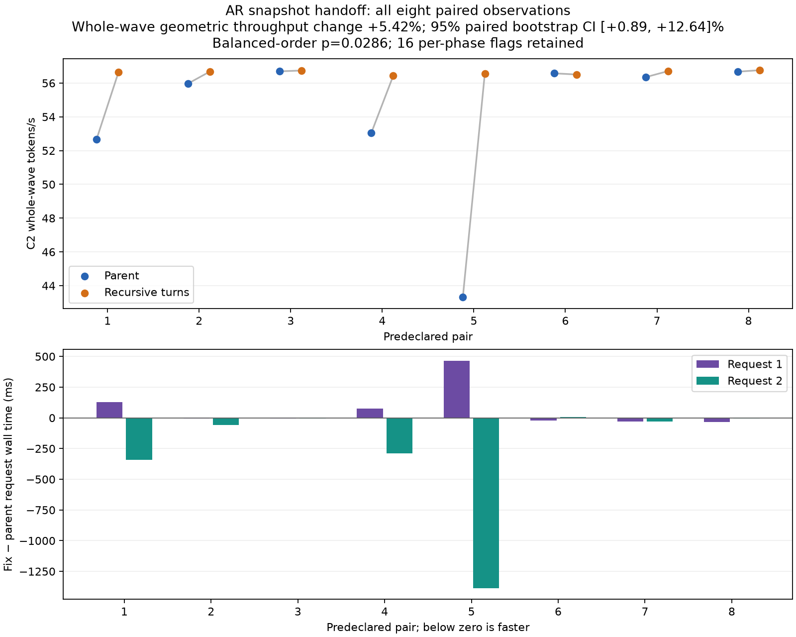
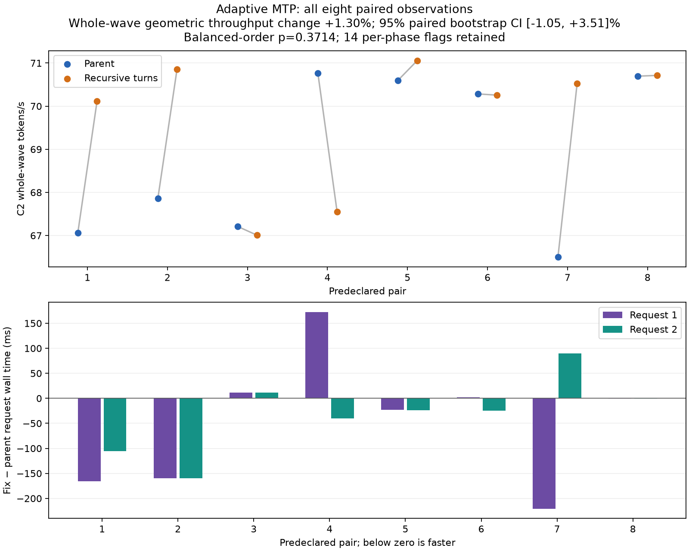

# Give pending TP snapshots a turn before AR advances

A pending snapshot can be starved by repeated autoregressive advances acquiring
the TP call mutex. On two Strix Halo nodes, an exact lock-site trace measured a
601.138 ms wait while 22 additional `Advance` calls acquired the same mutex. The
capture returned 3.875 ms after acquiring it. Other histories reproduced waits
of 2,239 and 888 ms. This is a host lock-handoff mechanism, separate from the
storage stalls investigated elsewhere.

The existing pending-snapshot gate covers multi-token decode. This follow-up
extends admission to `Advance`, `AdvanceBatch`, `DecodeStep`, and `DecodeBatch`.
An outer turn waits before taking the call mutex. A nested turn on the same
runner proceeds so an active decode can finish its recursive `Advance`; waiting
there would deadlock the capture needing that mutex. A thread-local linked
stack also handles nested turns across different runners and exception unwind.

An active call is allowed to finish, and prefill is unchanged. The check can race
with a newly registered capture, so this is not strict FIFO or a universal wait
bound. There are no model-math, GPU-kernel, collective-order, transport, cache
policy, wire-protocol, or system-configuration changes.

## Evidence and scope

The three-file follow-up is based on the existing snapshot-handoff branch
`b6d4cbaa`; its code commit is `92bf7cb6`. It is independently CPU-tested and
format-checked on that published base. The private production/inference test
stack also contains HC/cooperative/cache changes absent from this older base.
The confidence results below qualify that integration-stack delta. Separate
standalone published-base AR/MTP checks are reported independently; their
timing flags remain open. Exact binary/source identities and settings
are in [qualification.json](qualification.json).

On the integration stack, the production build, sanitizer gate tests and five
CPU suites pass. An isolated negative control using unconditional nested waits
times out in the recursive-handoff test, demonstrating why nesting matters.
Actual two-node tests use Flash Next UD-Q4_K_XL, shared Q8_0 MTP when enabled,
65,536-token capacity, two sessions, CLI2K/backend4K and a 1 GiB cache budget.
Both hosts have 124 GiB HIP heaps and crossed 40+20 Gb/s links. The same temporary
driver is used in every paired arm and the approved drivers are restored.

### Untraced AR pilot

| Fixed execution order | Concurrent wave tok/s | Second-request first-followup gap ms |
|---|---:|---:|
| Parent before | 36.75 | 3342.25 |
| Fix first | 56.41 | 83.38 |
| Fix second | 56.52 | 83.87 |
| Parent after | 53.12 | 424.01 |

All 24 canonical request/output identities match. The first parent effectively
serializes the pair (physical width 1); the fix runs both requests together
(width 2). The first request therefore finishes later: 3662 ms versus 4512/4529
ms, while the second finishes sooner: 6956 ms versus 4528/4519 ms. Keep this
fairness/batching tradeoff distinct from a uniform latency improvement.
[All 22 timing flags](ar-phase-flags.csv) and
[four changed-width comparisons](ar-adaptive-work.csv) are retained. Controls
vary, and four fixed starts do not establish significance or stall frequency.
An instrumented parent/fix pair did not reproduce the large parent stall; it
does not prove a speedup.

### Predeclared AR confidence study

All eight balanced-order pairs complete:16fresh starts,80exact canonical
outputs,32clean host transport windows and approved-driver restoration.
Geometric C2 whole-wave throughput improves **5.415%**,95%paired-bootstrap
interval **[0.886,12.644]%**. Seven pairs favor the fix. The predeclared
256-sign symmetry p=0.0234375 and exact70balanced-assignment p=0.0285714.
The bootstrap assumes exchangeable pairs and the sign test assumes pairwise
symmetry; these support the measured history/stack, not arbitrary workloads.

All16strict phase flags remain. There are zero recorded draft/acceptance/round/
maximum-width differences; reaching width two does not mean the whole execution
mix is identical. In pair5 the first request takes4061.795→4525.313ms
(**463.517ms longer**) while the second takes5899.713→4514.532ms; whole-wave
completion improves5.910203→4.525313s. Retain this fairness/batching tradeoff.
Second-request first-followup gaps in pairs1/4/5 shrink551.572/475.501/1908.570ms
→82.941/84.738/83.190ms. This is reduced handoff stalling, not faster GPU math.

No metric has two candidate observations above every baseline by the unchanged
margin; overlapping ranges do not clear individual flags. Secondary C1 first-
decode latency reduction0.414%,CI[0.162,0.652]%,balanced p=.02857 is exploratory;
repeat0.124%,CI[−0.215,+0.426]%,p=.57143 is inconclusive. These are not replacement
primary endpoints or a blanket C1 improvement claim.

[Every pair](ar-confidence-rates.csv), [all flags](ar-confidence-flags.csv),
[work comparisons](ar-confidence-work.csv), [ranges](ar-confidence-ranges.csv),
[numerical results](ar-confidence.json), [C1 secondary results](ar-confidence-C1.json),
[validation](ar-confidence-validation.json) and
[statistics](ar-confidence-statistics.py) are retained. Same binaries/settings
as the AR pilot, same five-request prefix, only trailing32K omitted; no observers,
admin sampler, extra idle or warming. No pilot rows pooled or starts excluded.



### MTP and functional checks

The normal adaptive-MTP pilot has 24 matching canonical outputs, but concurrent
rates are 64.88/63.31 tok/s in controls and 57.27/68.99 in fix runs. Preserve
[25 timing flags](mtp-phase-flags.csv) and
[23 changed-work comparisons](mtp-adaptive-work.csv). There is no demonstrated
adaptive-MTP improvement or clearance of its slow candidate cohort.

A separate supported `--draft-tokens 1 --min-draft-tokens 1` diagnostic matches
all 12 outputs and recorded draft/acceptance/round/width counts, with no strict
timing flags: 71.00 versus 71.04 concurrent tok/s. This different workload does
not clear adaptive-mode flags or recommend a new default. The attempted floor
of two was rejected by Flash Next before model loading completed; it is not a
benchmark result.

The subsequent predeclared eight-pair normal-adaptive comparison completes all
16 starts and 80 matching canonical outputs, without exclusions or added
starts. Paired geometric concurrent throughput change is +1.302%, with 95%
paired-bootstrap interval [−1.053,+3.511]%; the predeclared sign-symmetry p is
0.3125 and exact balanced-order sensitivity p is 0.371429. Five pairs favor the
fix, three favor the parent. This establishes neither a gain nor a slowdown,
and is not equivalence. The bootstrap assumes exchangeable pairs; the two
p-values have different symmetry/randomization assumptions, both retained.

All 14 new timing flags remain: eight public/raw decode comparisons across
four C2 requests and six warmup metrics. Thirty draft-work comparisons differ.
Every flagged C2 comparison has changed draft work, without establishing that
as the entire cause. No metric has two candidates outside every observed
baseline by the unchanged margin. No C1 strict flags; exploratory C1 first/
repeat latency changes −0.065/−0.175% have intervals spanning zero. Earlier
pilot flags remain separate. This narrows the concern to variable adaptive
work/overlapping timings; it does not give a blanket per-request pass.

[All pair rates](mtp-confidence-rates.csv), [flags](mtp-confidence-flags.csv),
[changed work](mtp-confidence-work.csv), [ranges](mtp-confidence-ranges.csv),
[numerical results](mtp-confidence.json) and the
[statistical calculation](mtp-confidence-statistics.py) are retained. The
same warmup/first-repeat2K/C2 prefix is used, omitting only trailing32K after
the affected requests. Explicit max7/min1, same binaries and controls, no
profiler/admin sampler/extra priming. All 32 host windows are clean; tested
servers exit and approved drivers restore.



Candidate functional coverage includes 23 HTTP requests: two concurrent
victim/survivor orders, exact survivor/post-cancel replay, and two deep seeded
continuations retaining/discarding interrupted assistant output. All six client
disconnects join by request ID to server `finish=cancelled` outcomes. Both deep
cases reuse 18,461 tokens and reproduce their seeded continuation and third-turn
outputs exactly. Actual two-row survivors and MTP proposals are checked.
Checked transport counters stay clean and tested servers exit. This does not
qualify process loss, cable loss, persistence or overnight operation.

## Standalone published-base hardware checks

These are separate from the private integration stack: parentb6d4cbaa/ac0f26eb
versus published code92bf7cb6/binary0ced6bf2. The three task source hashes match
the integration prototype; all290actual normalized compile commands match.
No private HC/cooperative/cache patches are present. Settings match the studies
above, including the common temporary844Edriver and crossed40+20Gb/s links.

Four fixed starts (ARparent/candidate, MTPparent/candidate) complete24exact
canonical identities, eight clean host transport windows, final driver restore,
server exit and frozen/runtime/boot/topology/kernel checks. They retain
[24phase flags](standalone-flags.csv) and [six work changes](standalone-work.csv).
AR C2whole-wave rates56.343→56.221tok/s; MTP66.719→55.586tok/s. The latter has
~0.77srequest-wall slowdowns and changed proposals/acceptances/rounds. This is an
open regression signal, not a qualified penalty or something cleared by private-
stack confidence. ARsecond-request gap/snapshot flags are~26–27ms. One pair per
mode cannot establish direction, equivalence or a standalone5.4%gain.

Candidate-only functional checks then pass independently in **both AR and MTP**:
23HTTPrequests per mode, six request-ID-matched server cancellations per mode,
actual width-two survivors and exact post-cancel replay. Both seeded keep/discard
continuations reuse18,461tokens and exactly reproduce continuation/third-turn
outputs. ARhas zero proposals; MTPdeep cases propose1/9tokens, with substantive
proposals also required on solo/survivor/replay requests. Both modes restore
approved drivers and pass cleanup/counter/kernel/inventory checks. These are
functional checks, not matched timing controls or process/cable-loss coverage.

[Mode results](standalone-modes.json), [validation](standalone-modes-validation.json),
[source/build provenance](standalone-source.json) and
[functional results/validation](standalone-functional.json) are retained.
A separate predeclared eight-pair standalone adaptive-MTP follow-up is running
with explicit max7/min1, same five-request prefix and no profiler/adminsampler.
No interim aggregate analysis or transfer of private-stack performance claims.

## Review status

Keep this follow-up a draft. The integration AR confidence endpoint supports
a gain with a first-request tradeoff; individual flags remain open. Standalone
AR/MTP functional checks pass, but affected timing follow-up remains pending,
alongside adaptive-MTP timing uncertainty. No default deployment,
universal deadlock clearance or blanket speedup is claimed. Existing snapshot-
handoff PRs retain their own review state.

## CPU reproduction

With the project's CPU test dependencies available:

```bash
cmake --preset cpu-test -B build-cpu
cmake --build build-cpu --target tp_control_test tp_executor_test tp_snapshot_gate_test text_model_runner_test text_generation_scheduler_test --parallel 4
ctest --test-dir build-cpu --output-on-failure -R '^(tp_control_test|tp_executor_test|tp_snapshot_gate_test|text_model_runner_test|text_generation_scheduler_test)$'
c++ -std=c++20 -O1 -g -Wall -Wextra -Werror -fsanitize=address,undefined -pthread -I . tests/cli/tp_snapshot_gate_test.cpp -o /tmp/tp-snapshot-turn-test
timeout 20 /tmp/tp-snapshot-turn-test
```

Lab raw traces, per-request JSONL, exact frozen commands/settings, counter/kernel
windows and validators are preserved in `strix-dispatch-investigation` under
`hc-ar-snapshot-path-v1/v2`, `ar-snapshot-turn-trace-v1`,
`ar-snapshot-turn-pilot-v1`, `snapshot-turn-mtp-pilot-v1`,
`snapshot-turn-functional-v1`, and `snapshot-turn-mtp-fixed1-v1`.
